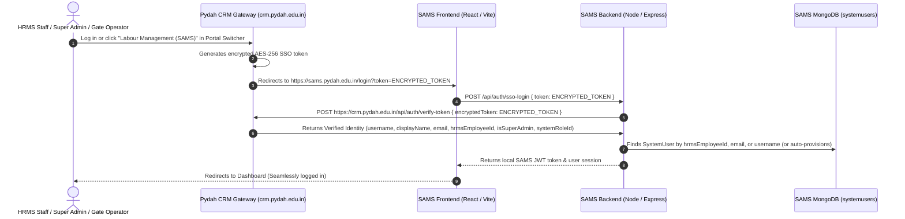

# SAMS (Labour Management System) - SSO & Portal Switcher Integration Guide

This guide provides step-by-step instructions for integrating **Single Sign-On (SSO)** and the **Universal Portal Switcher CDN** into the **SAMS Labour Management System** (`sams.pydah.edu.in`).

---

## 🏛️ System Architecture



---

## 📦 User Schema Compatibility

The SAMS `SystemUser` model (`backend/src/models/SystemUser.js`):

```javascript
import mongoose from 'mongoose';

const systemUserSchema = new mongoose.Schema(
  {
    username: { type: String, required: true, unique: true, lowercase: true, trim: true },
    passwordHash: { type: String, required: true, select: false },
    displayName: { type: String, required: true, trim: true },
    email: { type: String, default: '', trim: true, lowercase: true },
    hrmsEmployeeId: { type: String, default: undefined },
    systemRoleId: { type: mongoose.Schema.Types.ObjectId, ref: 'SystemRole', default: null },
    isSuperAdmin: { type: Boolean, default: false },
    divisionIds: [{ type: mongoose.Schema.Types.ObjectId, ref: 'Division' }],
    gateIds: [{ type: mongoose.Schema.Types.ObjectId, ref: 'Gate' }],
    gateAccessModes: { type: Map, of: String, default: () => new Map() },
    departmentIds: [{ type: mongoose.Schema.Types.ObjectId, ref: 'Department' }],
    departmentAccessModes: { type: Map, of: String, default: () => new Map() },
    allowedLocationIds: [{ type: mongoose.Schema.Types.ObjectId, ref: 'GeoLocation' }],
    isActive: { type: Boolean, default: true },
    lastLoginAt: { type: Date, default: null },
  },
  { timestamps: true }
);

systemUserSchema.index({ systemRoleId: 1, isActive: 1 });
systemUserSchema.index(
  { hrmsEmployeeId: 1 },
  { unique: true, partialFilterExpression: { hrmsEmployeeId: { $type: 'string' } } }
);

export default mongoose.model('SystemUser', systemUserSchema);
```

> [!NOTE]
> When an employee switches from HRMS, CRM, or Fee Management into SAMS, their identity resolves to their `hrmsEmployeeId` (e.g. `"2144"`). The SAMS backend checks for a matching `SystemUser` record by `hrmsEmployeeId`, `email`, or `username`.

---

## 🔑 1. Backend Implementation (SAMS Backend)

### Step 1.1: Verify Token Endpoint Details

The central CRM Auth Gateway provides token verification:

- **Production URL**: `https://crm.pydah.edu.in/api/auth/verify-token`
- **Development URL**: `http://localhost:8000/api/auth/verify-token`
- **Method**: `POST`
- **Headers**: `Content-Type: application/json`

#### Request Payload:

```json
{
  "encryptedToken": "CibJqICeMLnJDqwUmmh5Y6iytNz+QQwts9g9F+GfLE..."
}
```

#### Successful Response Payload:

```json
{
  "success": true,
  "valid": true,
  "data": {
    "userId": "6718a2bc4f9e8a0012bc34de",
    "username": "2144",
    "name": "Ravi Kumar",
    "displayName": "Ravi Kumar",
    "email": "ravi@pydah.edu.in",
    "hrmsEmployeeId": "2144",
    "employeeId": "2144",
    "empNo": "2144",
    "role": "super_admin",
    "isSuperAdmin": true,
    "systemRoleId": "6718a2bc4f9e8a0012bc34df",
    "divisionIds": [],
    "gateIds": [],
    "departmentIds": [],
    "allowedLocationIds": [],
    "portalId": "sams",
    "expiresAt": "2026-10-23T06:45:00.000Z"
  }
}
```

---

### Step 1.2: Add SSO Login Endpoint in SAMS Backend

In your SAMS backend auth routes (e.g., `backend/src/routes/auth.routes.js` or `backend/src/controllers/auth.controller.js`):

```javascript
import axios from 'axios';
import jwt from 'jsonwebtoken';
import SystemUser from '../models/SystemUser.js';

const CRM_AUTH_URL = process.env.CRM_AUTH_URL || 'https://crm.pydah.edu.in';
const JWT_SECRET = process.env.JWT_SECRET || 'your-sams-jwt-secret';

/**
 * POST /api/auth/sso-login
 * Verifies encrypted token from CRM Gateway and establishes SAMS session
 */
router.post('/sso-login', async (req, res) => {
  try {
    const { token } = req.body;

    if (!token) {
      return res.status(400).json({
        success: false,
        message: 'SSO token is required'
      });
    }

    // 1. Verify token with CRM Gateway
    let crmResponse;
    try {
      crmResponse = await axios.post(
        `${CRM_AUTH_URL}/api/auth/verify-token`,
        { encryptedToken: token },
        { headers: { 'Content-Type': 'application/json' }, timeout: 10000 }
      );
    } catch (apiErr) {
      console.error('[SAMS-SSO] CRM verify-token failed:', apiErr.response?.data || apiErr.message);
      return res.status(401).json({
        success: false,
        message: apiErr.response?.data?.message || 'Invalid or expired SSO token'
      });
    }

    const crmData = crmResponse.data?.data;
    if (!crmData) {
      return res.status(401).json({
        success: false,
        message: 'Invalid CRM token response'
      });
    }

    const {
      userId,
      username,
      displayName,
      email,
      hrmsEmployeeId,
      employeeId,
      isSuperAdmin
    } = crmData;

    const empId = hrmsEmployeeId || employeeId;

    console.log(`[SAMS-SSO] Verified CRM user: ${displayName || username} (Emp: ${empId}, Email: ${email})`);

    // 2. Locate SystemUser in SAMS database
    const orConditions = [];
    if (empId) {
      orConditions.push({ hrmsEmployeeId: empId });
    }
    if (email) {
      orConditions.push({ email: email.toLowerCase() });
    }
    if (username) {
      orConditions.push({ username: username.toLowerCase() });
    }
    if (userId && /^[0-9a-fA-F]{24}$/.test(userId)) {
      orConditions.push({ _id: userId });
    }

    let user = await SystemUser.findOne({
      $or: orConditions,
      isActive: true
    }).populate('systemRoleId');

    // 3. Auto-provision if user does not exist yet (e.g. HRMS admin logging in for first time)
    if (!user) {
      console.log(`[SAMS-SSO] Auto-provisioning new SAMS SystemUser for: ${displayName || username}`);
      user = new SystemUser({
        username: (username || (email ? email.split('@')[0] : empId)).toLowerCase(),
        displayName: displayName || username || 'SAMS Operator',
        email: email || '',
        hrmsEmployeeId: empId || undefined,
        passwordHash: 'SSO_MANAGED_AUTHENTICATION',
        isSuperAdmin: Boolean(isSuperAdmin),
        isActive: true,
        lastLoginAt: new Date()
      });
      await user.save();
    } else {
      user.lastLoginAt = new Date();
      await user.save();
    }

    // 4. Generate local SAMS JWT
    const samsToken = jwt.sign(
      {
        userId: user._id.toString(),
        username: user.username,
        displayName: user.displayName,
        email: user.email,
        hrmsEmployeeId: user.hrmsEmployeeId,
        isSuperAdmin: user.isSuperAdmin,
        systemRoleId: user.systemRoleId?._id || user.systemRoleId,
        divisionIds: user.divisionIds,
        gateIds: user.gateIds,
        departmentIds: user.departmentIds
      },
      JWT_SECRET,
      { expiresIn: '8h' }
    );

    // 5. Return authenticated session
    return res.status(200).json({
      success: true,
      message: 'SSO login successful',
      token: samsToken,
      user: {
        id: user._id.toString(),
        username: user.username,
        displayName: user.displayName,
        email: user.email,
        hrmsEmployeeId: user.hrmsEmployeeId,
        isSuperAdmin: user.isSuperAdmin,
        systemRoleId: user.systemRoleId,
        divisionIds: user.divisionIds,
        gateIds: user.gateIds,
        departmentIds: user.departmentIds
      }
    });
  } catch (error) {
    console.error('[SAMS-SSO] Login handler error:', error);
    return res.status(500).json({
      success: false,
      message: 'Internal server error during SSO login'
    });
  }
});
```

---

## 💻 2. Frontend Implementation (SAMS Frontend)

### Step 2.1: Intercept `?token=` on Login Page

In your SAMS login page (`frontend/src/pages/Login.jsx` or `App.jsx`):

```jsx
import React, { useEffect, useState } from 'react';
import { useNavigate, useLocation } from 'react-router-dom';
import axios from 'axios';

const API_BASE_URL = import.meta.env.VITE_API_URL || 'https://sams-backend.pydah.edu.in';

export default function Login() {
  const navigate = useNavigate();
  const location = useLocation();
  const [isVerifying, setIsVerifying] = useState(false);
  const [error, setError] = useState('');

  useEffect(() => {
    const urlParams = new URLSearchParams(location.search);
    const ssoToken = urlParams.get('token');

    if (ssoToken) {
      handleSSOLogin(ssoToken);
    }
  }, [location.search]);

  const handleSSOLogin = async (token) => {
    setIsVerifying(true);
    setError('');

    try {
      // 1. Clear old local sessions to avoid session bleeding
      localStorage.removeItem('token');
      localStorage.removeItem('sams_token');
      localStorage.removeItem('user');
      localStorage.removeItem('sams_user');
      sessionStorage.clear();

      // 2. Call SAMS backend SSO login
      const response = await axios.post(`${API_BASE_URL}/api/auth/sso-login`, { token });

      if (response.data.success && response.data.token) {
        // 3. Store new session
        localStorage.setItem('token', response.data.token);
        localStorage.setItem('sams_token', response.data.token);
        localStorage.setItem('user', JSON.stringify(response.data.user));
        localStorage.setItem('sams_user', JSON.stringify(response.data.user));

        // 4. Clean token from address bar URL
        window.history.replaceState({}, document.title, window.location.pathname);

        // 5. Dismiss switcher transition screen & navigate
        window.PydahSwitcher?.hideTransition();
        navigate('/dashboard', { replace: true });
      } else {
        throw new Error(response.data.message || 'SSO authentication failed');
      }
    } catch (err) {
      console.error('[SAMS] SSO login failed:', err);
      setError(err.response?.data?.message || err.message || 'SSO verification failed.');
      window.PydahSwitcher?.hideTransition();
    } finally {
      setIsVerifying(false);
    }
  };

  // Display seamless branded loader during SSO verification
  if (isVerifying) {
    return <pydah-sso-loader portal="sams" title="Labour Management (SAMS)"></pydah-sso-loader>;
  }

  return (
    <div className="login-container">
      {/* Existing manual username/password login form */}
      {error && <div className="alert-error">{error}</div>}
      <form onSubmit={/* standard login */}>
        {/* ... */}
      </form>
    </div>
  );
}
```

---

## 🌐 3. Embed Universal Portal Switcher (CDN Widget)

To allow SAMS users to seamlessly jump between **HRMS, Fee Management, Transport, Admissions, SRS, and CRM**:

### Add Script to `frontend/index.html`:

Place this single script tag right before `</body>`:

```html
<!-- Pydah Universal Portal Switcher CDN -->
<script
  src="https://crm.pydah.edu.in/portal-switcher.js"
  data-current-portal="sams"
  data-api-base-url="https://crm.pydah.edu.in"
  async>
</script>
```

#### Configuration Attributes:

| Attribute               | Value                             | Description                                                           |
| ----------------------- | --------------------------------- | --------------------------------------------------------------------- |
| `data-current-portal` | `"sams"`                        | Identifies this application as SAMS                                   |
| `data-api-base-url`   | `"https://crm.pydah.edu.in"`    | Base URL for the CRM Gateway                                          |
| `data-position`       | `"bottom-right"` *(optional)* | Position of floating button (`"bottom-right"` or `"bottom-left"`) |

---

## ⚙️ 4. Environment Variables Checklist

### CRM Gateway (`crm-backend/.env`):

```env
# Add the MongoDB connection URI for the SAMS database (only this is needed):
SAMS_MONGO_URI=mongodb+srv://<username>:<password>@<cluster>.mongodb.net/sams
# Note: Portal URL (https://sams.pydah.edu.in/login) is already hardcoded in constants.js & switcher scripts
```

### SAMS Backend (`SAMS/backend/.env`):

```env
CRM_AUTH_URL=https://crm.pydah.edu.in
JWT_SECRET=your-sams-jwt-secret
PORT=5002
```

---

## ✅ 5. Verification Checklist

1. **Direct SSO Switch**: Log into CRM (`https://crm.pydah.edu.in`), HRMS (`https://hrms.pydah.edu.in`), or SRS, and click **Labour Management (SAMS)** in the Portal Switcher.
2. Confirm you are redirected to `https://sams.pydah.edu.in/login?token=...`.
3. Confirm that SAMS backend calls `POST https://crm.pydah.edu.in/api/auth/verify-token` and returns `200 OK`.
4. Confirm you are logged in and landed on the SAMS dashboard!
